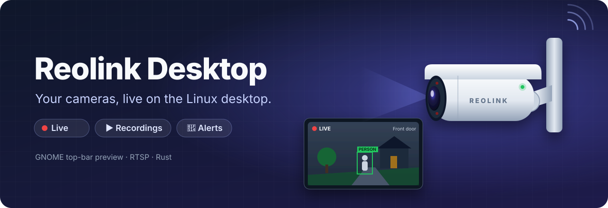
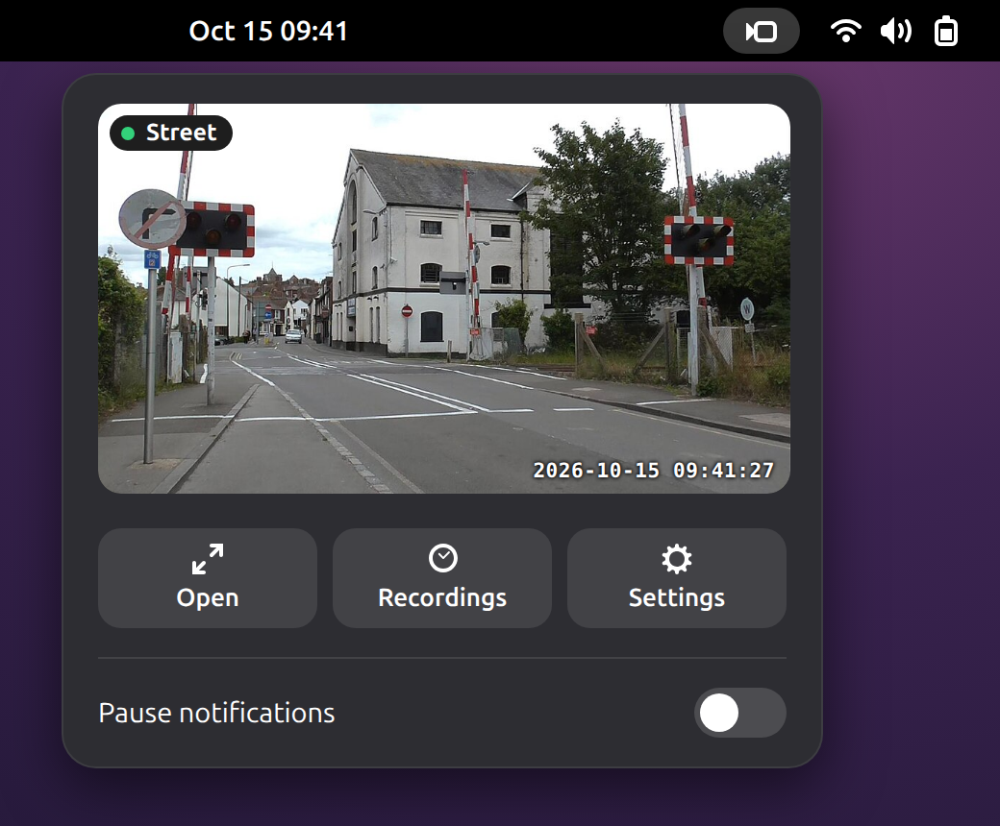

<p align="center">
  
</p>

# Reolink Desktop

Watch your Reolink cameras from the Linux desktop. Click the camera icon in the top bar to see
them live, browse the recordings, and get a notification when someone walks by.

> This is an independent project. It is not affiliated with Reolink.

<p align="center">
  
  <br>
  <sub>Click the camera icon in the GNOME top bar to see your cameras live.<br>
  Sample camera image: <a href="https://commons.wikimedia.org/wiki/File:Rye_Level_Crossing_(Ferry_Road_Crossing)_(open).jpg">Nathan A RF</a>, <a href="https://creativecommons.org/licenses/by-sa/4.0">CC BY-SA 4.0</a>.</sub>
</p>

## Features

- **Live preview in the top bar.** Click the camera icon to see your cameras right away (GNOME).
- **Live window.** Show one camera full size, or all of them in a grid.
- **Recordings.** Play back the camera's SD card by day: play, pause, seek, save clips.
- **Alerts.** Get desktop notifications for motion, people, vehicles and animals, with a
  snapshot.
- **Spotlight and snapshots** with one click.
- **Several cameras**, each with its own settings.
- **Follows your theme.** Light or dark mode and your accent colour.

## Requirements

- Linux with **GNOME 48 or newer** (Ubuntu 25.04+ or Debian 13+). On other desktops
  (KDE, XFCE…) you get a regular tray icon instead of the top-bar preview.
- A **Reolink camera** on your network with **RTSP** and **HTTPS** turned on. These are on by
  default on most models.

The app is tested with a Reolink RLC-510A.

## Install

### Option 1: download the package (easiest)

1. Download the latest `.deb` from the [Releases](https://github.com/h4ndsh/reolink-desktop/releases) page.
2. Install it:
   ```bash
   sudo apt install ./reolink-desktop_*_amd64.deb
   ```
3. **Log out and log back in** (needed once, so GNOME loads the top-bar menu).
4. Open **Reolink Desktop** from your applications.

### Option 2: build it yourself

```bash
git clone https://github.com/h4ndsh/reolink-desktop.git
cd reolink-desktop
make deps      # installs Rust and the build tools (asks for your password)
make install   # builds and installs the package
```

Then log out and back in, as in step 3 above.

## Getting started

1. On first launch, the **Add Camera** form opens. Enter the camera's IP address, username
   and password, click **Test Connection** to check them, then click **Add Camera**.
2. Click the **camera icon** in the top bar to see the live preview. From there you can open
   the full window, the recordings or the settings.
3. To manage cameras, go to **Settings → Cameras**. Click **Add** for a new one, or use ✎ to
   edit and 🗑 to remove a camera.

> **Tip:** create a separate user on the camera just for this app.

## Where your files go

| What | Where |
|---|---|
| Settings and cameras | `~/.config/reolink-desktop/config.toml` (only you can read it) |
| Snapshots | `~/Pictures/Reolink` |
| Saved clips | `~/Videos/Reolink` |

## Troubleshooting

**There is no camera icon in the top bar.**
Log out and back in. If it is still missing, turn the extension on:
```bash
gnome-extensions enable reolink-desktop@reolink-desktop.github.io
```

**The icon is there, but the menu shows only text, with no video.**
That is the generic tray icon, which appears when the extension is off. Enable it with the
command above.

**"Stream unavailable".**
Check the IP address and password, and that RTSP is on in the camera's settings
(*Network → Advanced → Server Settings*). Choosing the **Sub** stream also helps on slow Wi-Fi.

**The camera shows "Offline".**
Make sure **Use HTTPS** is on in the camera's settings in the app. Recent firmware turns plain
HTTP off.

**I want to see what is happening.**
Run the app from a terminal with logs:
```bash
pkill reolink-desktop; RUST_LOG=reolink_desktop=debug reolink-desktop
```

## Uninstall

```bash
sudo apt remove reolink-desktop
rm -rf ~/.config/reolink-desktop   # optional: also delete your settings
```

## For developers

```bash
make test    # run the tests
make run     # run from source
make         # build the .deb into dist/
```

[docs/ARCHITECTURE.md](docs/ARCHITECTURE.md) explains how the app is built, the D-Bus
interface, and the full configuration reference.

## License

[MIT](LICENSE). Reolink is a trademark of its owner.
